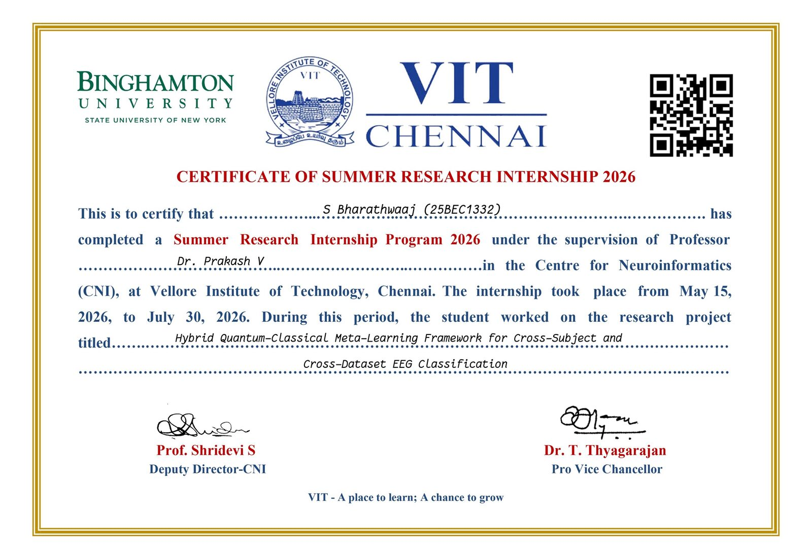
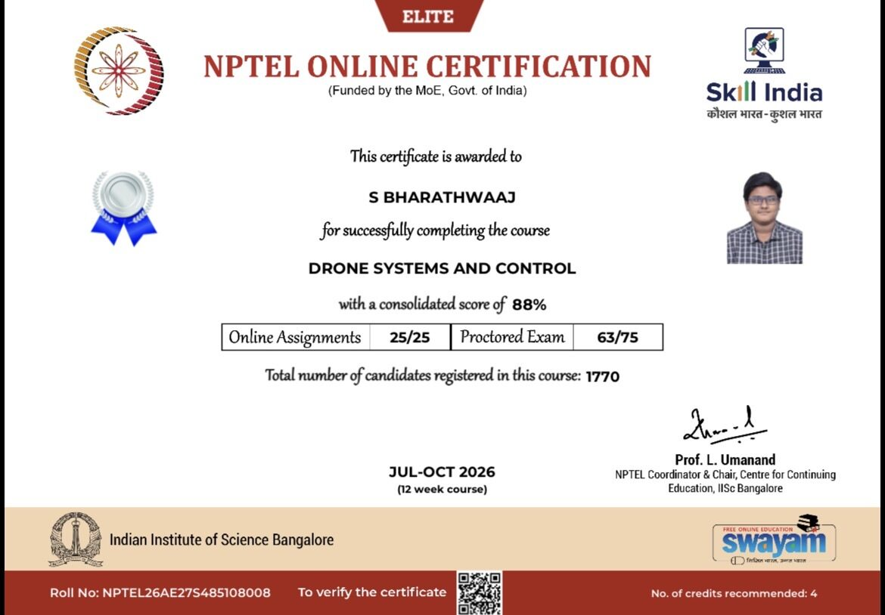
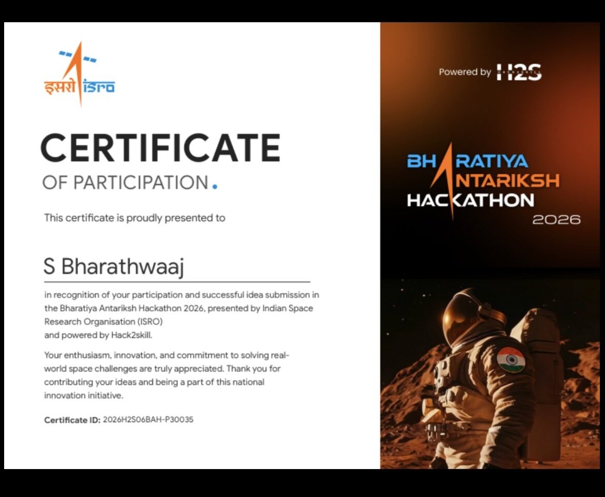
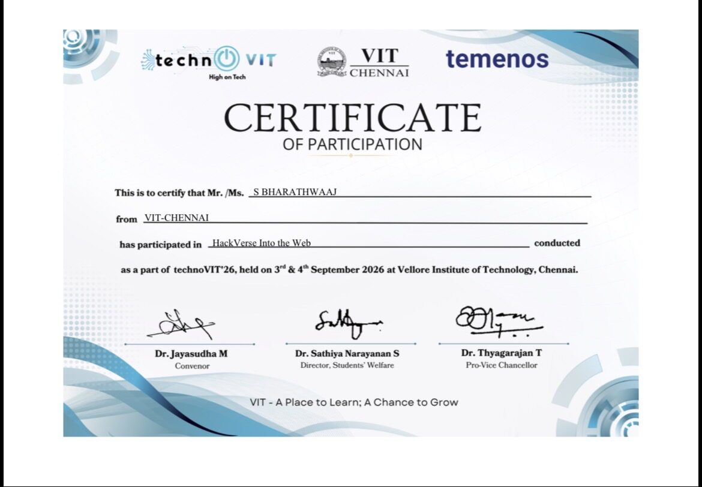
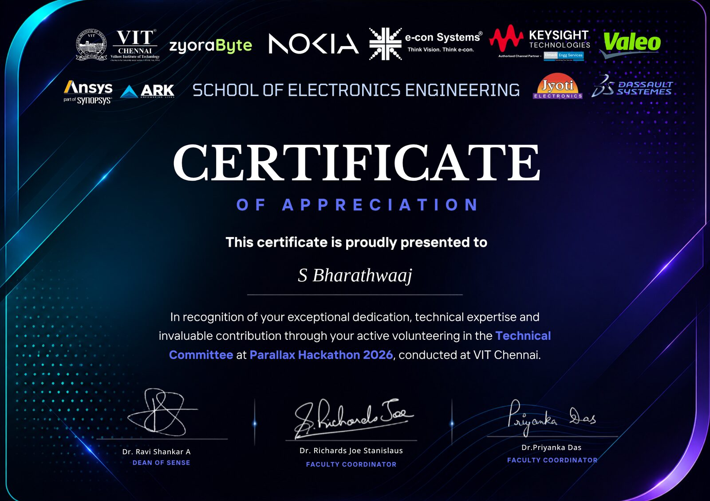
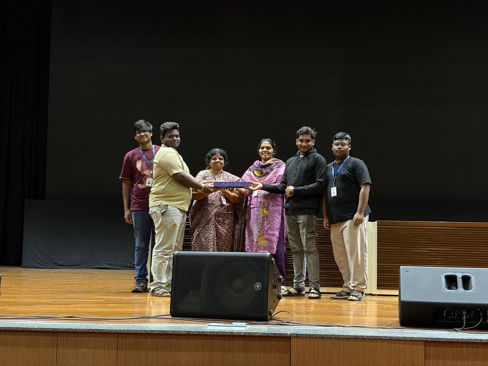

# Hi, I'm Bharathwaaj 👋

ECE student at **VIT Chennai** (2025–2029). I build robots, drones and embedded hardware, and I do most of my design work in Fusion 360 with 3D printing.

## 🔧 Projects
| Project | What it is |
|---|---|
| [Project NIDAR](https://github.com/bharathwaaj-subramanian/project-nidar) | Frame design for an indoor-maze competition drone (Pixhawk 6X, Jetson Orin NX, LiDAR) |
| [Temperature-Controlled Clock](https://github.com/bharathwaaj-subramanian/temperature-controlled-clock) | Analog NE555 + op-amp clock that throttles itself and switches on a fan when overloaded |
| [RFID Smart Billing Cart](https://github.com/bharathwaaj-subramanian/rfid-smart-billing-cart) | Raspberry Pi cart that bills items automatically, with a 3D-printable body |
| [Obstacle-Avoiding Robot Arm](https://github.com/bharathwaaj-subramanian/obstacle-avoiding-robot-arm) | Arduino car with ultrasonic obstacle avoidance and a pick-and-place arm |
| [Robo Soccer Car](https://github.com/bharathwaaj-subramanian/robo-soccer-car) | Electronics and 3D-printed scoop for the technoVIT'26 robo soccer event |
| [DIY Spectrophotometer](https://github.com/bharathwaaj-subramanian/diy-spectrophotometer) | Arduino-based colour spectrophotometer in a 3D-printed enclosure |
| [Digital Voting Machine](https://github.com/bharathwaaj-subramanian/digital-voting-machine) | Logic-IC voting machine with 7-segment displays |
| [Solar Tracker](https://github.com/bharathwaaj-subramanian/solar-tracker) | Light-following solar panel |
| [RC Aircraft (OpenVSP)](https://github.com/bharathwaaj-subramanian/rc-aircraft-openvsp) | Conceptual fixed-wing aircraft model |

## 🔬 Research
**Summer Research Intern, Centre for Neuroinformatics, VIT Chennai** (May–July 2026)
- Supervisor: Dr. Prakash V
- Project: *Hybrid Quantum-Classical Meta-Learning Framework for Cross-Subject and Cross-Dataset EEG Classification*

## 🏅 Certifications & events
- **NPTEL Drone Systems and Control** (IISc Bangalore): Elite, 88%, Jul–Oct 2026
- **Bharatiya Antariksh Hackathon 2026** (ISRO): participant, idea submitted
- **HackVerse: Into the Web**, technoVIT'26: participant
- **Parallax Hackathon 2026**, VIT Chennai: Technical Committee volunteer
- **Robo soccer**, technoVIT'26: competitor
- **Special Prize**, VIT Chennai

## 🛠️ Tools
Fusion 360 · 3D printing · OpenVSP · LTspice · MATLAB · Python · Arduino · Raspberry Pi · Pixhawk · Jetson

## 📫 Connect
[LinkedIn](https://www.linkedin.com/in/bharathwaaj-subramanian-5066a0368)

Certificates

